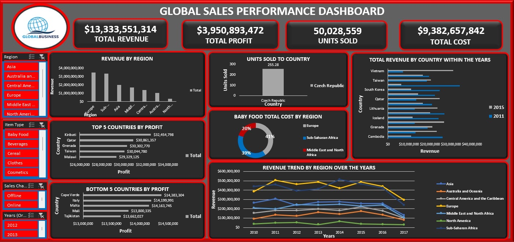
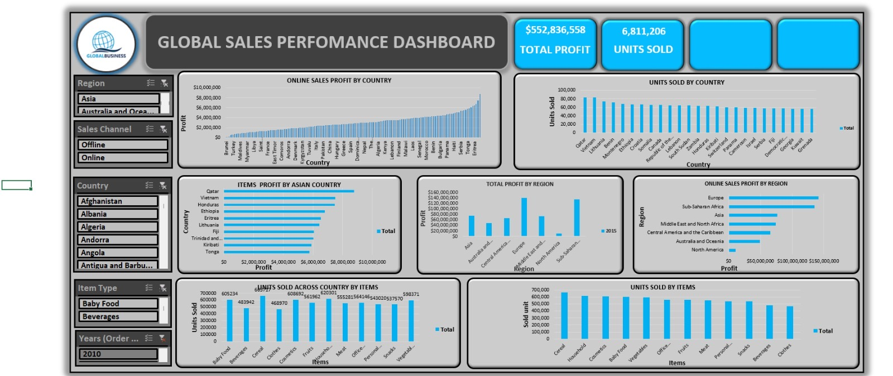

# Global-sales-performance-dashboard
Interactive Excel dashboard analyzing global sales performance across regions, countries, product categories, and sales channels, with insights into revenue, profit, costs, and units sold.
## 📊 Dashboard Preview

### Dashboard Overview

### Dashboard Analysis

🎥 [Watch the project demo on LinkedIn](https://www.linkedin.com/posts/udokanma-anthony-nyenke-99864b412_just-completed-my-microsoft-excel-data-activity-7477703777937072130-aWw1?utm_source=share&utm_medium=member_ios&rcm=ACoAAGkaO8QBPiadmsQcNs6YyXb4qds1reLdTbk)
(https://www.linkedin.com/posts/udokanma-anthony-nyenke-99864b412_microsoftexcel-dataanalytics-dataanalysis-activity-7478565055459106816-mrbG?utm_source=share&utm_medium=member_ios&rcm=ACoAAGkaO8QBPiadmsQcNs6YyXb4qds1reLdTbk)

Global Sales Performance Dashboard | Excel Data Analytics Project

Project Overview

This project focuses on analyzing global sales data using Microsoft Excel to understand business performance across different regions, countries, product categories, sales channels, and years.

The dashboard transforms sales data into interactive visual reports that help users explore revenue, profit, total costs, units sold, and regional performance. It was designed to make business trends easier to understand and support data-driven decision-making.

Project Objectives

* Analyze total revenue, profit, costs, and units sold.
* Compare sales performance across geographical regions and countries.
* Identify the top-performing and lowest-performing countries by profit.
* Examine product category performance and profitability.
* Compare online and offline sales channels.
* Track revenue and sales trends over time.
* Present key business metrics in an interactive dashboard.

Tools and Technologies

* Microsoft Excel — data analysis and dashboard development.
* PivotTables and PivotCharts — summarizing and visualizing sales data.
* Excel Slicers and Filters — exploring performance across different categories.
* Data Visualization — presenting business metrics and trends through charts and KPI cards.

The tools listed above should reflect the features actually used in your final workbook.

Dashboard Features

1. Key Performance Indicators (KPIs)

The dashboard presents high-level business metrics, including:

* Total Revenue
* Total Profit
* Total Cost
* Total Units Sold

2. Regional Sales Analysis

Compares performance across regions, including Europe, Asia, Sub-Saharan Africa, North America, Australia and Oceania, and other geographical areas represented in the dataset.

3. Country-Level Profitability

Highlights the top five and bottom five countries by profit, helping users explore differences in country-level business performance.

4. Product and Item Analysis

Examines product categories such as Baby Food, Beverages, Cereal, Clothes, Cosmetics, Fruits, Household products, Meat, Office Supplies, Personal Care, Snacks, and Vegetables.

5. Sales Channel Analysis

Allows users to explore sales performance by online and offline channels.

6. Revenue Trends

Uses time-series charts to compare revenue across regions over multiple years and identify changes in performance.

7. Interactive Filtering

Dashboard filters allow users to explore the data by region, country, item type, sales channel, and year, where supported by the workbook.

Business Questions Addressed

* How much revenue and profit does the business generate?
* Which regions contribute most to overall revenue?
* Which countries generate the highest and lowest profits?
* Which product categories account for the most units sold?
* How do online and offline sales compare?
* How does regional revenue change over time?
* Which areas may require further business investigation?

Key Business Insights

The dashboard supports the exploration of several important business questions:

* Regional performance: Compare revenue and profitability across geographical markets to identify stronger and weaker-performing regions.
* Country profitability: Identify countries at the top and bottom of the profit rankings for further investigation.
* Product performance: Compare units sold across product categories to understand differences in sales volume.
* Sales channel performance: Explore differences between online and offline sales.
* Performance over time: Track changes in regional revenue to identify growth, decline, and potential opportunities.

Specific conclusions should be confirmed using the final workbook and its filter settings before being presented as definitive findings.

Skills Demonstrated

* Data analysis using Excel
* Data summarization and aggregation
* PivotTables and PivotCharts
* Interactive dashboard development
* KPI reporting
* Business performance analysis
* Data visualization
* Analytical thinking
* Translating data into business insights

Project Deliverables

* Interactive Global Sales Performance Dashboard
* Dashboard screenshots and visual documentation
* Excel workbook containing the dashboard and supporting analysis, where included in the repository

How to Explore the Project

1. Open the dashboard screenshots in this repository.
2. Review the KPI cards to understand the overall business metrics.
3. Explore the charts to compare regions, countries, and product categories.
4. Use the available slicers in the Excel workbook to investigate different segments and time periods.
5. Compare the results to identify patterns and potential business opportunities.

Conclusion

This project demonstrates how Microsoft Excel can be used to transform global sales data into a structured and interactive business dashboard. By combining key performance indicators, comparative charts, and interactive filters, the dashboard makes it easier to explore business performance and identify areas for further analysis.

The project reflects my practical experience in Excel-based data analysis, dashboard development, data visualization, and communicating business information through visual reports.

⸻

Project Type: Data Analytics and Business Intelligence
Tool: Microsoft Excel
Focus Areas: Sales Performance, Profitability, Regional Analysis, Product Analysis, and Business Reporting
Created by: Data Analyst Portfolio Project
